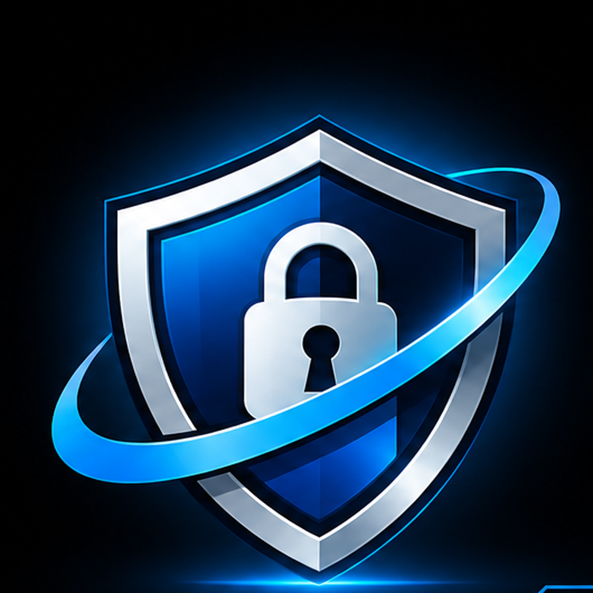
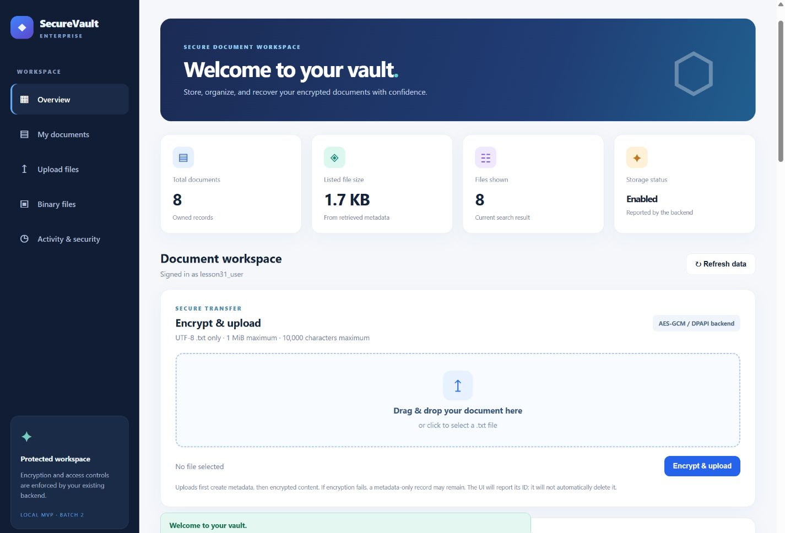
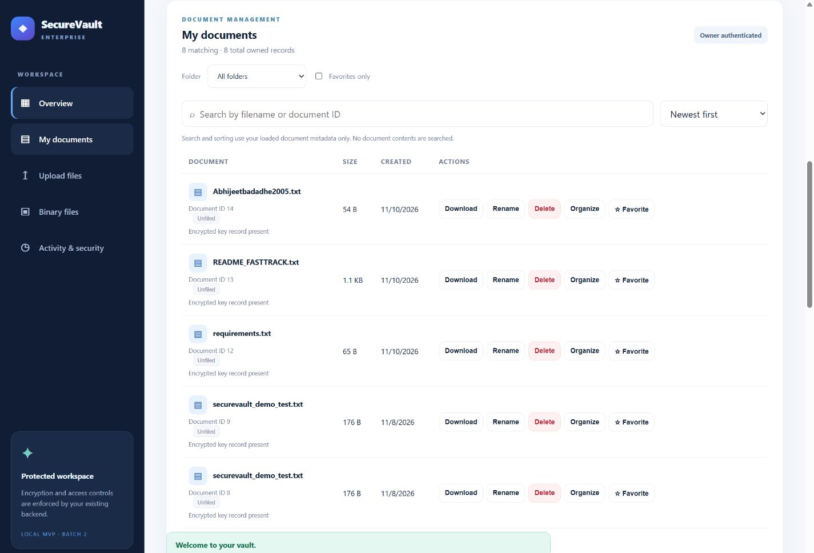
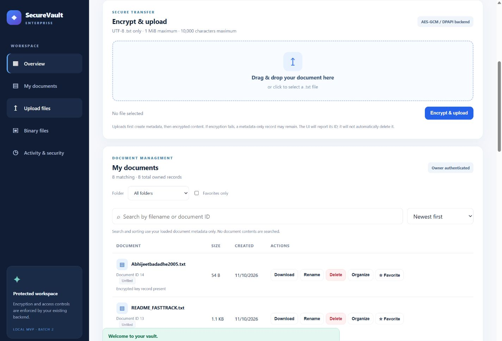
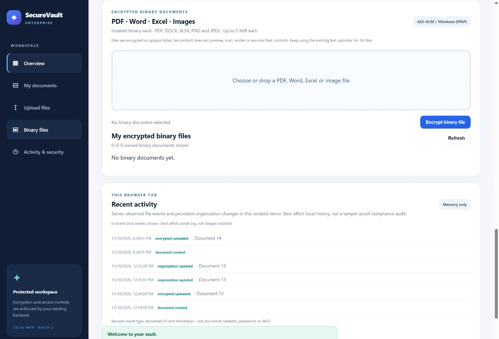
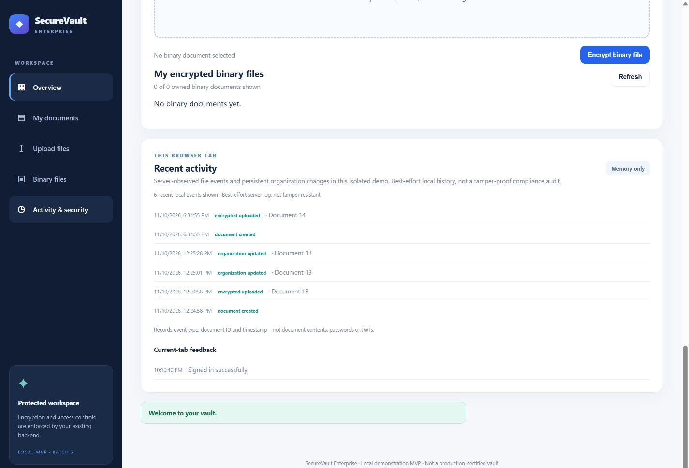
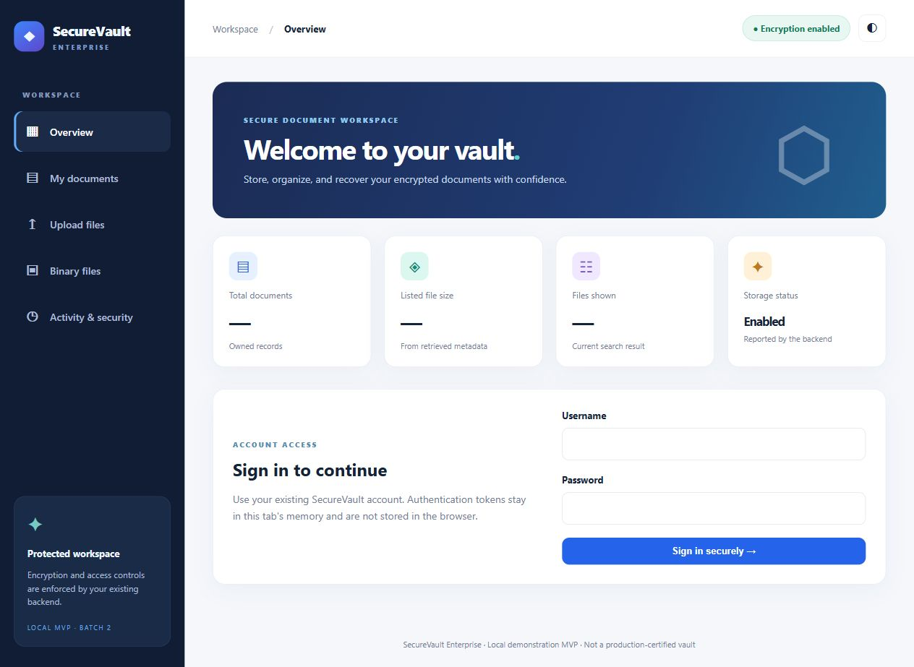
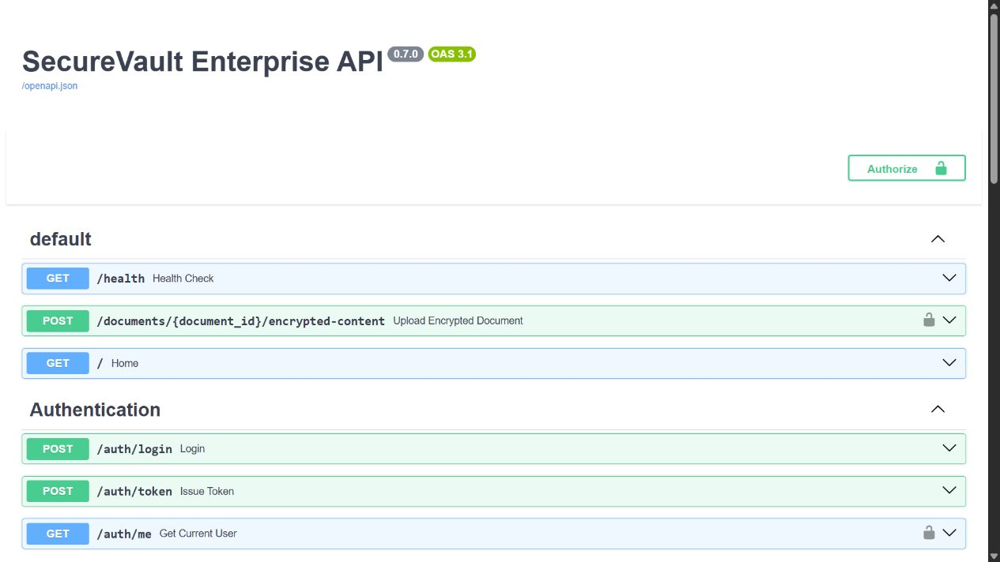

<div align="center">

<h1 align="center">&nbsp; SecureVault Enterprise</h1>

### An encrypted document vault: data-at-rest protection with strong, owner-scoped access control.

[](https://github.com/nimeshupadhyay12/Secure-Vault-Enterprise/actions/workflows/ci.yml)
[](https://www.python.org/)
[](https://fastapi.tiangolo.com/)
[](https://www.sqlite.org/)
[](https://cryptography.io/)
[](https://learn.microsoft.com/windows/win32/api/dpapi/)

**[Features](#features) · [Quick start](#quick-start) · [Crypto design](#cryptographic-design) · [Auth design](#authentication-design) · [Threat model](#threat-model) · [API](#api) · [Configuration](#configuration) · [Tests](#tests-and-ci)**

</div>

---

## Overview

SecureVault Enterprise is a FastAPI + SQLite document vault with a browser dashboard. Every document is encrypted with its own AES-256-GCM data key; data keys are wrapped by a key-encryption key (KEK) that never touches disk in the clear (Windows DPAPI by default, or an external master key on Linux/CI). Users sign in with Argon2id-hashed passwords and get 15-minute JWT access tokens plus rotating refresh tokens, and every document operation is scoped to its owner. Every download is re-verified against the SHA-256 recorded at upload, and security events go to a hash-chained, tamper-evident audit log.

> **Status:** local MVP built for learning and demonstration. It has not been independently penetration-tested or cryptographically reviewed. See the [threat model](#threat-model) and [limitations](#limitations).

## Features

| Area | What it does |
|---|---|
| Encryption at rest | AES-256-GCM, fresh 256-bit DEK and 96-bit nonce per document; DEK wrapped by the KEK (envelope encryption) |
| Context binding | AAD binds every ciphertext and wrapped DEK to owner id, document id, storage id and filename, so swapped or re-assigned files fail to decrypt |
| Integrity | SHA-256 recorded at upload, re-checked after decryption on every download path (`hmac.compare_digest`), returned as `X-Content-SHA256` and checked again in the browser for encrypted-document downloads |
| Key protection | Pluggable key provider: DPAPI (default on Windows, bound to the key id) or AES-GCM master key (`SECUREVAULT_MASTER_KEY`) |
| Key rotation | `manage rotate-kek` re-wraps every DEK under a new KEK without touching any ciphertext file |
| Documents | `.txt`, `.pdf`, `.docx`, `.xlsx`, `.png`, `.jpg/.jpeg` up to 5 MiB, with structural type checks and zip-bomb limits |
| Authentication | Argon2id (pinned parameters, rehash on login), 15-min HS256 access JWT, refresh-token rotation with reuse detection, logout and revocation |
| Brute force | Per-username lockout (429 + `Retry-After`) and a dummy Argon2 verify for unknown usernames (no timing oracle) |
| Access control | Every document, organiser and binary-vault query is filtered by the authenticated owner; other users' items answer 404 |
| Audit | Hash-chained (optionally HMAC-keyed) audit log of sign-ins, document changes, uploads/downloads and integrity failures; `manage audit-verify` |
| Fail-safe startup | Encrypted storage starts only after key-file ACL, directory ACL, process identity, path topology, schema and key-recovery checks pass; otherwise the API refuses to start and says why |
| HTTP hardening | CSP, nosniff, frame denial, no-referrer, no-store, optional HSTS, request-size cap, CORS off unless exact origins are configured |
| Operations | `manage setup` (one command), `check`, `create-user`, `audit-verify`, `rotate-kek`; GitHub Actions on Windows and Ubuntu |

## Quick start

Requires Python 3.12. Create the virtual environment **outside** the repository (or use the gitignored `.venv/`).

### Windows (DPAPI key provider, the default)

```powershell
git clone https://github.com/nimeshupadhyay12/Secure-Vault-Enterprise.git
cd Secure-Vault-Enterprise
python -m venv .venv
.\.venv\Scripts\Activate.ps1
pip install -r backend\requirements.txt

python -m backend.manage setup              # dirs, DBs, migrations, DPAPI-protected KEK, runtime\securevault.env
python -m backend.manage create-user alice  # password prompted (12+ characters)
uvicorn backend.api_main:app --host 127.0.0.1 --port 8766
```

Open <http://127.0.0.1:8766/vault> and sign in. API docs: <http://127.0.0.1:8766/docs>.

### Linux / macOS (master-key provider)

```bash
python3 -m venv .venv && source .venv/bin/activate
pip install -r backend/requirements.txt
export SECUREVAULT_MASTER_KEY="$(python -c 'import base64,secrets;print(base64.b64encode(secrets.token_bytes(32)).decode())')"
# keep this key in a secret manager / service environment, never next to the vault files
python -m backend.manage setup
python -m backend.manage create-user alice
uvicorn backend.api_main:app --host 127.0.0.1 --port 8766
```

`setup` is idempotent: running it again verifies the existing KEK and never replaces keys or secrets. For a throw-away development setup on Linux, `setup --dev-master-key` stores a generated master key in the config file (development only).

### What `setup` creates

```
runtime/                        (gitignored)
├── securevault.env             paths, random JWT secret, audit HMAC key, process SID/uid
├── data/securevault.db         users, documents, wrapped DEKs, refresh tokens, revocations, lockouts, audit log
├── data/vault_organization.db  folders / tags / favourites
├── data/vault_binary.db        binary-vault metadata
├── encrypted-files/*.svenc     document ciphertext       (restricted to the current account)
├── binary-files/*.svbin        binary-vault ciphertext   (restricted to the current account)
└── protected-keys/<id>.dpapi   KEK protected by DPAPI (or <id>.kek with the env provider)
```

Directories are restricted to the current account (protected DACL with only the user and SYSTEM on Windows, `0700` elsewhere) and `setup` finishes by running the same preflight the API runs at startup. `python -m backend.manage check` repeats that preflight at any time and prints the exact reason for a failure.

## Architecture

```
Browser (frontend/vault.js)        tokens in memory only; verifies X-Content-SHA256 (encrypted-document downloads)
        │  same origin
        ▼
FastAPI app (backend/api_main.py → create_app)
  ├─ core/http_security.py         headers, CSP, request cap, CORS
  ├─ api/auth.py                   /auth/token|refresh|logout|me → security/sessions.py, tokens.py, passwords.py
  ├─ api/private_documents.py      metadata CRUD (owner-scoped)
  ├─ security/encrypted_upload_router.py / encrypted_download_router.py   (only after preflight)
  │     └─ practice_document_service.py  AES-GCM + AAD, SHA-256 verify
  │           └─ windows_kek_store.py → key_provider.py (DPAPI | master key)
  ├─ api/vault_binary.py           binary vault (only after preflight)
  ├─ api/vault_organizer.py        folders/tags + activity feed from the audit log
  └─ security/audit_log.py         hash-chained audit trail
SQLite (main DB, organiser DB, binary DB) + ciphertext directories
Startup guards: key_file_guard → acl_guard → identity_guard → deployment_guard → registration (schema + KEK recovery)
Configuration: core/settings.py (env → runtime/securevault.env → defaults)
Operations: backend/manage.py (setup, check, create-user, audit-verify, rotate-kek)
```

## Cryptographic design

**Key hierarchy**

```
DPAPI (current Windows user)  or  SECUREVAULT_MASTER_KEY (AES-256-GCM)
        │ protects
        ▼
KEK (256-bit, one per key id, protected-keys/<id>.dpapi|.kek)
        │ wraps (AES-256-GCM, fresh 96-bit nonce, AAD)
        ▼
DEK (256-bit, one per document) → stored wrapped (48 bytes) in encrypted_document_keys / binary_documents
        │ encrypts (AES-256-GCM, fresh 96-bit nonce, AAD)
        ▼
Ciphertext file <random 128-bit storage id>.svenc = nonce(12) ‖ ciphertext ‖ tag(16)
```

* **Nonces:** 96-bit random values; every DEK encrypts exactly one plaintext and every wrap uses a fresh random nonce, so (key, nonce) reuse is avoided by design for DEKs and is negligibly unlikely for the KEK (random 96-bit nonces).
* **AAD (document path):** JSON `["SecureVault-L47-v1", kind, owner_id, document_id, storage_id, filename]` with `kind` = `file` for the content and `key` for the wrapped DEK. Binary vault: `["SV-BINARY-1", owner, file_id, storage_id, filename]` plus `|file` / `|key`. Moving a ciphertext to another row, owner, id or filename makes GCM authentication fail. (Consequence: renaming an encrypted document is refused with 409.)
* **KEK at rest:** DPAPI blobs use optional entropy `SecureVault-KEK-v2:<key_id>`, so a renamed key file is useless; legacy files without entropy are still read. The master-key provider stores `SVK1 ‖ nonce ‖ AES-GCM(KEK)` with AAD `securevault-kek-v1:<key_id>`.
* **Integrity:** the plaintext SHA-256 is stored with the wrapped DEK (`content_sha256`, migration 004) and in the metadata. After decryption it is compared in constant time; a GCM failure or a mismatch returns `500 Document failed integrity verification` and writes an `integrity_failure` audit event. Rows written before migration 004 still decrypt and get their fingerprint recorded on the first GCM-authenticated read.
* **Rotation:** `rotate-kek` unwraps each DEK with the KEK named in its row and re-wraps it under the new KEK in one transaction per database; ciphertext files are not touched. The old KEK file is kept for older backups.

## Authentication design

* **Passwords:** Argon2id, `t=3, m=64 MiB, p=4, hash_len=32, salt_len=16` (RFC 9106 second profile, above the OWASP minimum of m=19 MiB, t=2, p=1), pinned in code and visible in the encoded hash (`$argon2id$v=19$m=65536,t=3,p=4$…`). Weaker stored hashes are upgraded on the next successful login (`check_needs_rehash`). New passwords: 12–1024 characters, small blocklist, must not contain the username (NIST SP 800-63B style).
* **Access token:** HS256 JWT, 15 minutes, claims `sub, iss, aud, iat, nbf, exp, jti, typ=access` all required; `algorithms=["HS256"]` is pinned so `alg:none` and algorithm confusion are rejected. The secret must be 32+ characters; documented/placeholder values are refused unless `SECUREVAULT_ENV=development`, which instead uses a random per-process secret (no hard-coded default exists).
* **Refresh token:** 256-bit opaque value; only its SHA-256 is stored. Each `/auth/refresh` marks the token used and issues a new one in the same family (2 h idle, 12 h absolute). Presenting a used or revoked token revokes the whole family (reuse detection).
* **Logout / revocation:** `/auth/logout` stores the access token's `jti` until it expires (checked on every request) and revokes the refresh family, or every refresh family of the user with `all_sessions: true`. Access tokens already issued to other devices are not revoked and stay valid until they expire (at most 15 minutes).
* **Lockout and enumeration:** 5 failures within 15 minutes lock that username for 15 minutes (429 + `Retry-After`), whether or not it exists. Unknown usernames still run one Argon2 verification, so response time does not reveal valid accounts. Failures, lockouts, refreshes, reuse and logouts are audited.
* **Browser:** tokens live only in a JavaScript closure (never localStorage); one shared refresh runs on a 401 and the request is retried once.

## Threat model

| Threat | Mitigation |
|---|---|
| Stolen disk, backup or copied vault folder | Documents are stored only as ciphertext with wrapped DEKs; the KEK is DPAPI-protected (needs the Windows user's credentials) or needs the external master key. Note: `runtime/securevault.env` holds the JWT secret and audit HMAC key (and the master key with `--dev-master-key`), so protect the runtime folder and keep backups of it separate |
| Attacker edits, swaps or truncates ciphertext / key rows | AES-GCM tags + AAD binding + SHA-256 re-check; failure is reported and audited, never returned as data |
| Another user tries to read or change a document | Every query filters by the authenticated owner; foreign ids answer 404 |
| Password guessing / credential stuffing | Argon2id, lockout, uniform responses and timing |
| Stolen access token | 15-minute lifetime; the token used to log out is revoked immediately, other sessions' access tokens expire within 15 minutes |
| Stolen refresh token | Rotation; reuse revokes the family for attacker and victim |
| Forged JWT | Pinned algorithm, required claims, audience/issuer/type checks, strong secret |
| Misconfigured deployment (broad key ACLs, wrong account, nested dirs) | Startup guards refuse to enable encrypted storage and explain why |
| Malicious uploads | Allow-listed types, structural checks, zip-bomb limits, always served as `attachment` + `octet-stream` + nosniff |
| Tampering with the audit trail | Hash chain (HMAC with `SECUREVAULT_AUDIT_KEY`), downgrade detection, `audit-verify` |

**Out of scope:** malware running as the vault's Windows user (it can call DPAPI), a compromised server process or administrator, memory scraping, and network attackers when the API is exposed without TLS (put it behind HTTPS and set `SECUREVAULT_HSTS=1`).

## API

| Method | Path | Auth | Purpose |
|---|---|---|---|
| GET | `/health` | none | Liveness |
| GET | `/vault`, `/vault/assets/{file}`, `/vault/status` | none | Dashboard shell and capability flag |
| POST | `/auth/token` | none | Username + password → access + refresh token |
| POST | `/auth/login` | none | Deprecated alias of `/auth/token` (same code path) |
| POST | `/auth/refresh` | refresh token | Rotate refresh token, new access token |
| POST | `/auth/logout` | Bearer | Revoke this access token and a refresh family (or all sessions) |
| GET | `/auth/me` | Bearer | Current identity |
| POST | `/documents/encrypted?filename=` | Bearer | One-step encrypted upload (octet-stream body) |
| POST | `/documents/{id}/encrypted-content?filename=` | Bearer, owner | Encrypt content for an existing metadata record |
| GET | `/documents/{id}/encrypted-content` | Bearer, owner | Decrypt + verify; bytes and `X-Content-SHA256` |
| GET / POST | `/documents/private` | Bearer | List (paginated) / create metadata |
| GET / PATCH / DELETE | `/documents/private/{id}` | Bearer, owner | Read / rename (409 if encrypted) / delete metadata + ciphertext |
| POST | `/documents/private/upload/check` | Bearer | Validate a text file without storing it |
| GET / POST | `/vault/binary/files` | Bearer | Binary vault list / upload |
| GET | `/vault/binary/files/{id}/download` | Bearer, owner | Decrypt + verify |
| DELETE | `/vault/binary/files/{id}` | Bearer, owner | Delete |
| GET | `/vault/organize/snapshot` | Bearer | Folders, tags, favourites, key-record flags |
| PUT | `/vault/organize/documents/{id}` | Bearer, owner | Update folder / tags / favourite |
| GET | `/vault/organize/activity` | Bearer | Caller's own audit-log entries |
| any | `/documents/inspect`, `/documents/metadata*` | n/a | Retired, always 410 |

Encrypted and binary routes are registered only when encrypted storage is enabled and the preflight passes.

## Configuration

Resolution order: environment variable → `runtime/securevault.env` (or `SECUREVAULT_CONFIG_FILE`) → default. `setup` writes the file; the authoritative list is `SETTINGS_REFERENCE` in `backend/app/core/settings.py`.

| Variable | Default | Purpose |
|---|---|---|
| `SECUREVAULT_ENV` | `production` | `development` allows an ephemeral JWT secret and placeholder secrets |
| `SECUREVAULT_CONFIG_FILE` | `runtime/securevault.env` | Config file location |
| `SECUREVAULT_DB_PATH` | `backend/data/securevault.db` (`setup`: `runtime/data/`) | Main database |
| `SECUREVAULT_ORG_DB_PATH` | `backend/data/vault_organization.db` | Organiser database |
| `SECUREVAULT_BINARY_DB_PATH` | `backend/data/vault_binary.db` | Binary-vault database |
| `SECUREVAULT_BINARY_STORAGE_DIR` | `../binary-files` (`setup`: `runtime/binary-files`) | Binary ciphertext directory |
| `SECUREVAULT_JWT_SECRET` | none (required) | HS256 secret, 32+ characters |
| `SECUREVAULT_KEY_PROVIDER` | `dpapi` on Windows, `env` elsewhere | KEK protection |
| `SECUREVAULT_MASTER_KEY` | none | Base64 32-byte master key for the `env` provider |
| `SECUREVAULT_AUDIT_KEY` | none (`setup` generates one) | HMAC key (32+ chars) for the audit chain |
| `SECUREVAULT_ENABLE_ENCRYPTED_UPLOAD` | `0` | `1` enables encrypted storage after preflight |
| `SECUREVAULT_UPLOAD_DB_PATH` | = `SECUREVAULT_DB_PATH` | Must equal the main DB if set |
| `SECUREVAULT_UPLOAD_STORAGE_DIR` | none | Document ciphertext directory |
| `SECUREVAULT_UPLOAD_KEK_DIR` | none | Protected KEK directory |
| `SECUREVAULT_UPLOAD_KEK_ID` | none | Active KEK id |
| `SECUREVAULT_UPLOAD_WINDOWS_SID` | none | Windows: SID the server must run as |
| `SECUREVAULT_UPLOAD_EXPECTED_UID` | none | Linux/macOS: uid the server must run as |
| `SECUREVAULT_MAX_DOCUMENT_BYTES` | `5242880` | Largest document (max 50 MiB) |
| `SECUREVAULT_MAX_REQUEST_BYTES` | `6291456` | Request-body cap (keep above the document limit) |
| `SECUREVAULT_LOGIN_MAX_FAILURES` | `5` | Failures before lockout |
| `SECUREVAULT_LOGIN_WINDOW_SECONDS` | `900` | Failure counting window |
| `SECUREVAULT_LOGIN_LOCKOUT_SECONDS` | `900` | Lockout duration |
| `SECUREVAULT_CORS_ORIGINS` | empty | Exact allowed origins (comma-separated); `*` refused |
| `SECUREVAULT_HSTS` | `0` | `1` sends Strict-Transport-Security |
| `SECUREVAULT_ENABLE_DOCS` | `1` | `0` hides `/docs`, `/redoc`, `/openapi.json` |

## Operator commands

```bash
python -m backend.manage setup [--runtime-dir DIR] [--key-id ID] [--provider dpapi|env] [--dev-master-key]
python -m backend.manage check                       # startup preflight with reasons
python -m backend.manage create-user USERNAME        # --password-stdin for automation
python -m backend.manage audit-verify [--db PATH]    # exit 1 if the chain is broken
python -m backend.manage rotate-kek --new-key-id ID  # stop the API first
```

## Tests and CI

```powershell
python -m pytest backend/tests -q
```

Current result on Windows 11 / Python 3.12 (real DPAPI):

```
129 passed, 1 skipped, 60 subtests passed
```

The skipped test checks POSIX permission bits and runs on Linux; on Linux the DPAPI-only test is skipped instead. Tests run in a temporary directory set up by `backend/tests/conftest.py` and never touch a real vault. They cover authentication (tokens, lockout, rotation, reuse, logout), Argon2 parameters and rehashing, key providers, settings, tamper detection on every download path, the audit chain, `setup`/`check`, startup guards, every supported file type end to end, owner scoping, the organiser, KEK rotation and HTTP hardening.

GitHub Actions (`.github/workflows/ci.yml`) runs the full suite on `windows-latest` and the provider-independent suite on `ubuntu-latest`, then runs `setup`, `check`, an app import with encrypted storage enabled and `audit-verify` on both.

## Repository structure

```
backend/
├── api_main.py        create_app(): routers, guards, HTTP hardening
├── manage.py          operator CLI
├── app/core/          settings.py, bootstrap.py (setup/check), http_security.py
├── app/api/           auth, private documents, binary vault, organiser, UI
├── app/security/      crypto, key providers, sessions, tokens, passwords, audit log, guards, rotation
├── app/database/      repositories and migrations 001-004
└── tests/             isolated unit and integration tests
frontend/              index.html, vault.css, vault.js
docs/                  IMPROVEMENTS.md, screenshots, assets
```

See [docs/IMPROVEMENTS.md](docs/IMPROVEMENTS.md) for every change made in the hardening pass and why.

## Limitations

* Single-process, local deployment; SQLite and file storage are not crash-atomic together (deletes use a reversible staging rename).
* Lockout is per username, so an attacker can temporarily lock a known account (availability trade-off); there is no per-IP throttling.
* The audit chain cannot detect truncation of the newest entries on its own; keep the head hash printed by `audit-verify` elsewhere.
* File-type checks are structural, not malware scanning.
* DPAPI ties the KEK to one Windows account and machine; plan key backup and recovery before storing real data.

## Screenshots

*Screenshots predate the hardening pass (wording on the upload and activity panels has changed).*

### Dashboard overview


### Document library and filters


### Encrypted upload


### Binary-file vault


### Activity and security


### Sign-in


### Interactive API documentation


## License

MIT, see [LICENSE](LICENSE).
